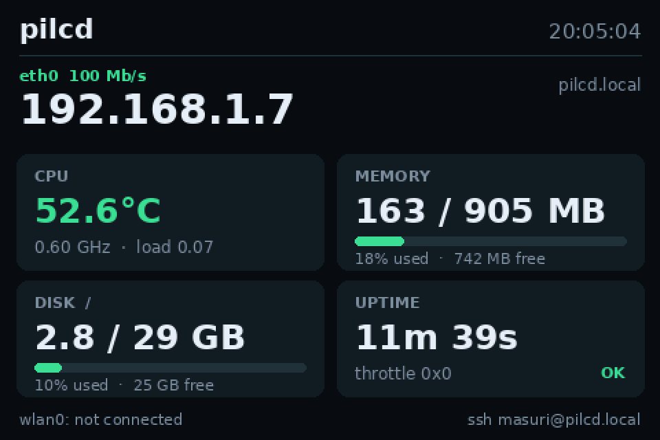

# rpi-lcd-dashboard

A tiny, dependency-light status panel for a **3.5" SPI TFT** on **Raspberry Pi OS Lite** — no desktop, no X, no Wayland. It paints straight into `/dev/fb0` and replaces the text console with a readable dashboard.



## Why

On Raspberry Pi OS Lite the SPI panel normally shows a 60×20 text console, which is hard to read at arm's length and buried under boot messages. This grabs the framebuffer, detaches the kernel console from it, and draws a 480×320 dashboard every 3 seconds.

It is **read-only**: no web server, no telemetry, no network calls. Everything comes from `/proc`, `/sys` and `vcgencmd`.

## What it shows

| Card | Contents |
|---|---|
| Header | hostname, live clock |
| Address | primary interface (Ethernet preferred, Wi-Fi fallback), link speed, IPv4, `.local` name, Wi-Fi address when both are up |
| CPU | SoC temperature (green <65 °C, amber ≥65, red ≥75), current clock, 1-min load |
| Memory | used / total, percentage bar, available |
| Disk | `/` usage, matching `df` |
| Uptime | uptime and `vcgencmd get_throttled` state |
| Footer | Wi-Fi radio state / SSID, SSH hint |

## Hardware

- Raspberry Pi 3B (any Pi with SPI works), 1 GB
- 3.5" 480×320 SPI TFT — ILI9486 + XPT2046 family, e.g. Waveshare 3.5" (A) or a goodtft `tft35a` panel
- Raspberry Pi OS Lite, Debian 13 (trixie), kernel 6.18 — verified on this setup

## Prerequisite: get the display working first

This repo does **not** include the panel overlay. Set the display up once with [goodtft/LCD-show](https://github.com/goodtft/lcd-show) or your vendor's instructions:

```bash
curl -fsSL -o /tmp/tft35a.dtbo \
  https://raw.githubusercontent.com/goodtft/LCD-show/master/usr/tft35a-overlay.dtb
sudo install -m 644 /tmp/tft35a.dtbo /boot/firmware/overlays/tft35a.dtbo
```

Then append to `/boot/firmware/config.txt`:

```ini
[all]
dtparam=spi=on
dtoverlay=tft35a:rotate=90
```

and reboot. A working setup shows the console on the panel and `fb_ili9486` in `dmesg`.

> **Watch out:** on Bookworm and later `/boot/config.txt` is only a stub that says *"DO NOT EDIT THIS FILE"* — the real file is `/boot/firmware/config.txt`. Old LCD-show scripts still write to `/boot/config.txt`, so they silently do nothing. Also skip their X11/fbcp steps on Lite.

## Install

```bash
git clone git@github.com:masrimustaman/rpi-lcd-dashboard.git
cd rpi-lcd-dashboard
sudo ./install.sh
sudo reboot
```

`install.sh` installs `python3-pil`, `python3-numpy` and DejaVu fonts, copies the script and unit, blacklists the touch driver, and enables `lcd-status.service`.

## Configuration

Everything is at the top of `/usr/local/bin/lcd_status.py`:

| Constant | Meaning |
|---|---|
| `INTERVAL` | seconds between repaints (default `3.0`) |
| `BG`, `CARD`, `TRACK`, `TEXT`, `DIM`, `ACCENT`, `AMBER`, `RED` | palette |
| `W`, `H` | panel size |

After editing, `sudo systemctl restart lcd-status`.

## How it works

- **Exclusive framebuffer.** On start the service writes `0` to `/sys/class/vtconsole/vtconN/bind` for the fbcon console, so kernel/getty output cannot overwrite the panel. It re-binds on clean shutdown, which puts the text console back.
- **RGB565.** Pillow renders RGB, numpy packs it to 16-bit and the raw bytes are written at offset 0 of `/dev/fb0` — the format fbtft expects.
- **Cheap.** Rendering plus the SPI push costs well under 1% of one core on a Pi 3B; `nmcli` is only spawned every 5–15 s and cached in between.

## Wi-Fi helper

The buttons are gone (this build is display-only), so radio control is a shell one-liner:

```bash
sudo lcd-wifi status     # radio state, wlan0 state, SSID
sudo lcd-wifi toggle     # on <-> off
sudo lcd-wifi on
sudo lcd-wifi off
```

It drives NetworkManager (`nmcli radio wifi ...`), and NM remembers the state across reboots.

## Touch panel

This build is **display-only**. `install.sh` blacklists the `ads7846` driver:

```bash
echo "blacklist ads7846" > /etc/modprobe.d/blacklist-ads7846.conf
```

Remove that file and reboot if you have a healthy touch panel and want the driver back. (An earlier revision of this project had on-screen Wi-Fi/shutdown buttons with a four-corner calibration wizard; it was removed after the resistive layer on this particular panel failed — one axis read full-scale regardless of touch position.)

## Troubleshooting

| Symptom | Likely cause |
|---|---|
| Panel blank, `fb_ili9486` missing in `dmesg` | overlay not loaded — check `/boot/firmware/config.txt` and `/boot/firmware/overlays/tft35a.dtbo` |
| Colours look swapped (blue for red) | panel is BGR — flip the red/blue handling in `to_rgb565()` |
| Image upside down | change `rotate=90` to `rotate=270` in `dtoverlay=tft35a:...` |
| Console text appears over the dashboard | the service isn't running, or fbcon re-bound itself — `systemctl status lcd-status` |
| `no address` in the big slot | no interface has an IPv4 address (`ip -br addr`) |
| Service restart loop | `journalctl -u lcd-status -n 30` |

## Uninstall

```bash
sudo ./uninstall.sh
sudo reboot
```

## License

MIT — see [LICENSE](LICENSE).
